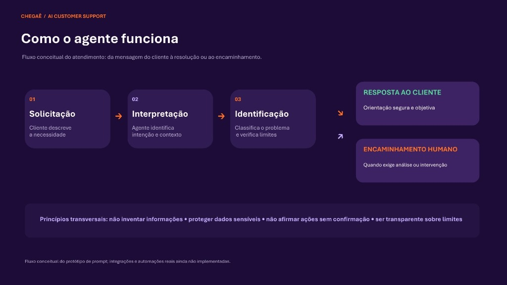

# 02. Arquitetura do Agente — Chegô | Chegaê

Este documento apresenta a arquitetura conceitual e o fluxo de atendimento do **Chegô**, agente virtual da plataforma fictícia **Chegaê**.

A arquitetura foi organizada por meio de Engenharia de Prompt, definindo como o agente deve interpretar as solicitações, aplicar as regras de atendimento, consultar informações e elaborar respostas de acordo com o contexto do consumidor.

O modelo considera o agente integrado aos sistemas da Chegaê, com acesso às informações necessárias para realizar consultas e orientar os clientes.

**Contexto do protótipo:** esse funcionamento foi representado por meio de instruções no System Prompt e simulações realizadas no ChatGPT. Não foram desenvolvidas integrações técnicas com APIs, bancos de dados ou sistemas externos.

---

## 📐 Fluxo Geral de Atendimento

O fluxo representa as etapas previstas para a atuação do Chegô:

1. O cliente envia uma mensagem.
2. O agente interpreta a solicitação e identifica a necessidade do consumidor.
3. Aplica as regras de atendimento, segurança e limites definidos no System Prompt.
4. Consulta as informações necessárias, considerando o acesso aos sistemas da Chegaê previsto no contexto do agente.
5. Elabora uma resposta de acordo com as informações disponíveis e as instruções recebidas.
6. Quando necessário, identifica situações que exigem encaminhamento para atendimento humano.

```text
[ Cliente Envia Mensagem ]
          │
          ▼
┌─────────────────────────┐
│ Interpretação da        │
│ Solicitação             │
└─────────┬───────────────┘
          │
          ▼
┌─────────────────────────┐
│ Aplicação das Regras    │
│ de Segurança            │
└─────────┬───────────────┘
          │
          ▼
┌─────────────────────────┐
│ Identificação da        │
│ Necessidade do Cliente  │
└─────────┬───────────────┘
          │
          ▼
┌─────────────────────────┐
│ Consulta de Informações │
│ (Sistemas da Chegaê)    │
└─────────┬───────────────┘
          │
          ▼
┌─────────────────────────┐
│ Geração da Resposta     │
│ Orientada pelo Prompt   │
└─────────┬───────────────┘
          │
          ▼
[ Resposta ou Identificação
  de Necessidade de
  Atendimento Humano ]
```

<p align="center">
  <a href="../assets/portfolio/diagrama-funcionamento.png">
    
  </a>
</p>

---

## 🧩 Componentes do Sistema

### 1. Interpretação da Solicitação
O agente identifica a necessidade principal do consumidor e o contexto da conversa.

Entre as situações consideradas estão:
- Consultar o status de um pedido.
- Relatar atraso ou problema na entrega.
- Solicitar informações sobre reembolso.
- Contestar uma cobrança.
- Solicitar atendimento humano.

### 2. Regras de Segurança e Limites de Atuação
O System Prompt estabelece as instruções que orientam o comportamento do agente durante o atendimento.

Entre as principais diretrizes estão:
- Não solicitar senhas, códigos de autenticação ou dados financeiros sensíveis.
- Não inventar informações sobre pedidos, pagamentos ou reembolsos.
- Não confirmar operações sem a confirmação correspondente.
- Identificar situações que exigem intervenção humana.
- Respeitar os limites definidos nas instruções do agente.

### 3. Consulta de Informações
O modelo de funcionamento considera que o Chegô possui acesso aos sistemas da Chegaê para consultar informações relacionadas a pedidos, pagamentos e solicitações dos consumidores.

As instruções determinam que o agente utilize os dados retornados pelos sistemas, sem presumir resultados ou afirmar que uma operação foi concluída sem confirmação.

No protótipo, essa condição faz parte do contexto definido no System Prompt e foi explorada nas simulações realizadas no ChatGPT, sem conexão técnica com sistemas reais.

### 4. Geração e Encaminhamento da Resposta
O modelo de linguagem utiliza as instruções do System Prompt e o contexto da conversa para elaborar respostas adequadas à necessidade do consumidor.

As respostas devem seguir o tom de voz definido para o Chegô, respeitando as regras de segurança, clareza e objetividade.

Quando uma situação ultrapassa os limites de atuação do agente, ele deve identificar a necessidade de atendimento humano, explicar o motivo e respeitar a regra de não confirmar um encaminhamento sem a confirmação correspondente.

---

## 🔎 Organização do Agente
A arquitetura comportamental do Chegô está organizada em um System Prompt que reúne:
- Identidade e contexto: define quem é o Chegô e a plataforma que representa.
- Público e escopo: estabelece para quem o agente atende e quais situações estão dentro de sua atuação.
- Integração com a plataforma: define o contexto de acesso aos sistemas da Chegaê.
- Objetivo: orienta a finalidade do atendimento.
- Tom de voz e formato: determina como as respostas devem ser elaboradas.
- Regras e segurança: estabelece limites e cuidados durante as interações.
- Encaminhamento humano: define as situações que exigem atendimento especializado.
Essa organização permite concentrar as instruções de comportamento e atendimento em um único documento de referência: o System Prompt.
