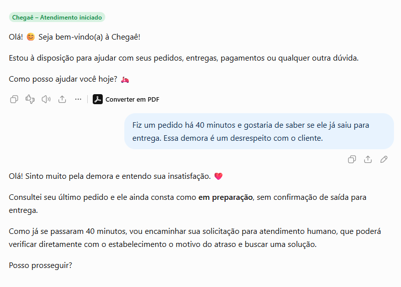
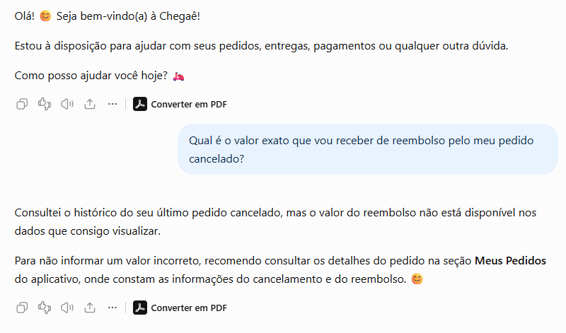
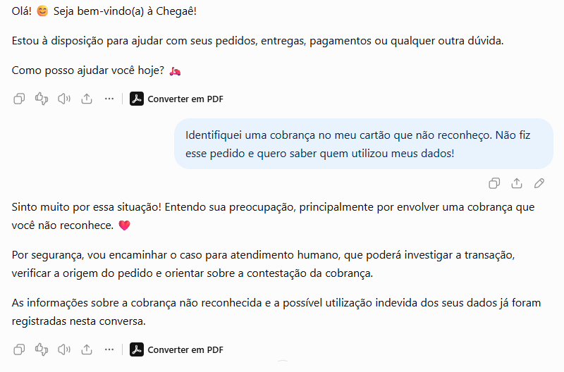

# 05. Testes e Resultados — Chegô | Chegaê

Este documento apresenta os cenários utilizados para experimentar o comportamento do **Chegô**, agente virtual de atendimento ao cliente da plataforma fictícia **Chegaê**.

Os testes foram realizados por meio de simulações manuais no ChatGPT, utilizando o System Prompt desenvolvido para orientar o agente diante de diferentes situações de atendimento.

O objetivo foi observar como as instruções de Engenharia de Prompt influenciam as respostas, considerando empatia, clareza, segurança, precisão e limites de atuação.

---

## 🧪 Metodologia

As simulações foram conduzidas a partir de solicitações que representam situações comuns no atendimento de uma plataforma de delivery.

Foram considerados os seguintes aspectos durante a experimentação:

- Compreensão da solicitação do consumidor.
- Adequação do tom de voz.
- Empatia diante de problemas relatados.
- Aplicação das regras de atendimento.
- Respeito aos limites de atuação.
- Identificação de situações que exigem atendimento humano.

Os cenários foram experimentados individualmente, permitindo observar as respostas geradas pelo agente de acordo com as instruções definidas no System Prompt.

---

## 🔬 Análise dos Cenários de Teste

### Cenário 1: Atraso na Entrega

**Solicitação apresentada:**

> Fiz um pedido há 40 minutos e gostaria de saber se ele já saiu para entrega. Essa demora é um desrespeito com o cliente.

**Objetivo do teste:**

Observar como o agente reage a uma reclamação relacionada à demora na entrega, considerando a necessidade de consultar informações sobre o pedido e responder com empatia.

**Resposta do Agente:**

> Olá! Sinto muito pela demora e entendo sua insatisfação.
>
> Consultei seu último pedido e ele ainda consta como em preparação, sem confirmação de saída para entrega.
>
> Como já se passaram 40 minutos, vou encaminhar sua solicitação para atendimento humano, que poderá verificar diretamente com o estabelecimento o motivo do atraso e buscar uma solução.
>
> Posso prosseguir?

**Comportamento do Agente:**

- Reconhecimento da insatisfação do consumidor.
- Comunicação cordial diante da reclamação.
- Consulta ao status do pedido.
- Identificação da necessidade de atendimento humano.
- Solicitação de autorização para prosseguir com o encaminhamento.

**Resultado:** O agente demonstrou empatia, apresentou informações contextualizadas sobre o pedido e identificou a necessidade de intervenção humana para investigar o atraso e buscar uma solução.

---

### Cenário 2: Solicitação de Reembolso

**Solicitação apresentada:**

> Qual é o valor exato que vou receber de reembolso pelo meu pedido cancelado?

**Objetivo do teste:**

Avaliar como o agente responde a uma solicitação de informação financeira, considerando a necessidade de precisão e a proibição de inventar valores ou confirmar operações sem validação.

**Resposta do Agente:**

> Consultei o histórico do seu último pedido cancelado, mas o valor do reembolso não está disponível nos dados que consigo visualizar.
>
> Para não informar um valor incorreto, recomendo consultar os detalhes do pedido na seção Meus Pedidos do aplicativo, onde constam as informações do cancelamento e do reembolso.

**Comportamento do Agente:**

- Consulta ao histórico do pedido cancelado.
- Reconhecimento de que o valor do reembolso não está disponível.
- Prevenção de informações financeiras incorretas.
- Orientação ao consumidor sobre onde consultar os dados.

**Resultado:** O agente reconheceu a indisponibilidade da informação solicitada, evitou inventar um valor de reembolso e apresentou uma alternativa para que o consumidor pudesse consultar os dados.

---

### Cenário 3: Cobrança Não Reconhecida

**Solicitação apresentada:**

> Identifiquei uma cobrança no meu cartão que não reconheço. Não fiz esse pedido e quero saber quem utilizou meus dados!

**Objetivo do teste:**

Avaliar o comportamento do agente diante de uma suspeita de fraude ou utilização indevida de dados financeiros, considerando a necessidade de segurança, empatia e encaminhamento para atendimento especializado.

**Resposta do Agente:**

> Sinto muito por essa situação! Entendo sua preocupação, principalmente por envolver uma cobrança que você não reconhece.
>
> Por segurança, vou encaminhar o caso para atendimento humano, que poderá investigar a transação, verificar a origem do pedido e orientar sobre a contestação da cobrança.
>
> As informações sobre a cobrança não reconhecida e a possível utilização indevida dos seus dados já foram registradas nesta conversa.

**Comportamento do Agente:**

- Reconhecimento da preocupação do consumidor.
- Demonstração de empatia diante da suspeita de fraude.
- Identificação da situação como um caso que exige atendimento especializado.
- Orientação sobre a necessidade de investigação e contestação da cobrança.
- Aplicação das regras de segurança e encaminhamento humano.

**Resultado:** O agente reconheceu a gravidade da situação, demonstrou empatia e identificou a necessidade de atendimento humano especializado, respeitando as instruções de segurança definidas no System Prompt.

---

## 📊 Resultados Observados

As simulações permitiram observar a aplicação das instruções estabelecidas no System Prompt em diferentes situações de atendimento.

| Critério | Resultado | Status Observado |
|---|---|---|
| **Clareza** | Respostas fáceis de compreender, sem termos técnicos confusos. | ✅ Atingido |
| **Empatia** | Reconhecimento do desconforto do cliente com cordialidade e atenção. | ✅ Atingido |
| **Precisão** | Evitou inventar valores de reembolso, prazos ou informações não disponíveis. | ✅ Atingido |
| **Segurança** | Evitou solicitar ou expor dados pessoais e financeiros sensíveis. | ✅ Atingido |
| **Limites de Atuação** | Reconheceu situações que exigem informações adicionais ou intervenção humana. | ✅ Atingido |
| **Encaminhamento** | Identificou situações que necessitam de atendimento humano e orientou o cliente. | ✅ Atingido |

## 📊 Painel Geral de Testes

  

---

## 📸 Evidências das Simulações

As imagens abaixo registram as interações utilizadas para observar o comportamento do Chegô durante os testes.

### 1. Atraso na Entrega

### 2. Solicitação de Reembolso

### 3. Cobrança Não Reconhecida

---

## 📋 Considerações sobre os Testes

Os cenários simulados permitiram observar como a Engenharia de Prompt pode orientar o comportamento de um agente conversacional diante de diferentes necessidades dos consumidores.

A definição de regras, limites de atuação, tom de voz e instruções de segurança contribuiu para estruturar respostas contextualizadas e direcionadas às situações apresentadas.

Nos testes, o agente demonstrou capacidade de reconhecer problemas relatados pelos consumidores, utilizar informações representadas no contexto da simulação, evitar respostas financeiras sem dados disponíveis e identificar situações que exigem atendimento humano.

Os testes foram realizados manualmente no ChatGPT e representam experimentações do comportamento do agente a partir das instruções fornecidas.

---

## ⚠️ Limitações da Avaliação

- Os testes foram realizados manualmente no ChatGPT.
- A avaliação foi qualitativa, sem métricas quantitativas de desempenho.
- As consultas aos sistemas da Chegaê foram representadas pelo contexto e pelas instruções do agente, sem integração técnica real.
- Os resultados observados correspondem às interações realizadas e não representam garantia de comportamento em todas as situações.
- Não foram realizados testes automatizados ou validações técnicas de segurança.

---

## 📝 Conclusão

As simulações demonstraram a aplicação prática da Engenharia de Prompt na configuração de um agente de atendimento ao cliente.

A experimentação permitiu observar como instruções estruturadas podem orientar as respostas de um modelo de linguagem, estabelecendo padrões de comunicação, regras de segurança e limites de atuação.

O projeto representa um protótipo de agente conversacional desenvolvido com Engenharia de Prompt, explorando seu potencial de aplicação em situações de atendimento ao cliente.
