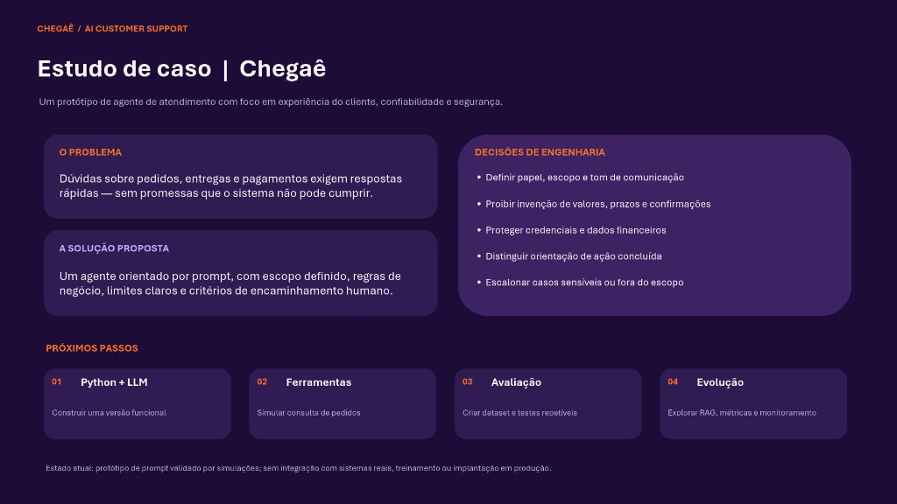

# 06. Estudo de Caso — Agente Chegô | Chegaê

## 📖 Resumo Executivo

O atendimento ao cliente em plataformas de entrega envolve diferentes situações que exigem respostas claras, rápidas e contextualizadas. Problemas como atrasos, pedidos cancelados, cobranças não reconhecidas e solicitações de reembolso podem gerar dúvidas e insatisfação nos consumidores.

O projeto apresenta o desenvolvimento do **Chegô**, agente virtual de atendimento ao cliente da plataforma fictícia **Chegaê**.

Por meio da **Engenharia de Prompt**, foi estruturado um System Prompt para orientar o comportamento de um modelo de linguagem, definindo sua identidade, responsabilidades, regras de atendimento, cuidados com a segurança das informações e limites de atuação.

O protótipo foi configurado e experimentado no ChatGPT por meio de simulações manuais de situações comuns de atendimento.

  

---

## 🎯 Desafio de Negócio

O projeto parte de problemas comuns no atendimento de plataformas de entrega:

- **Tempo de espera:** clientes precisam aguardar atendimento humano para esclarecer dúvidas e resolver problemas relacionados aos pedidos.
- **Falta de contextualização:** chatbots com fluxos rígidos podem ter dificuldade para compreender diferentes situações e necessidades.
- **Respostas incorretas:** modelos de IA generativa sem instruções adequadas podem inventar informações, como valores de reembolso, prazos e status de pedidos.
- **Segurança das informações:** situações envolvendo cobranças não reconhecidas e dados financeiros exigem cuidados específicos durante o atendimento.

---

## 💡 Decisões Estratégicas de Design do Agente

Durante a construção do System Prompt, foram definidas algumas decisões para orientar o comportamento do Chegô:

1. **Definição de identidade e escopo de atuação:**
   - Estabelecer o papel do agente, o contexto da plataforma e os tipos de solicitações que fazem parte do atendimento.

2. **Orientação para consultas e informações:**
   - Definir que o agente deve utilizar informações retornadas pelos sistemas da Chegaê, sem presumir ou inventar dados.
   - No protótipo, esse contexto de consulta foi representado nas simulações realizadas no ChatGPT.

3. **Segurança da informação:**
   - Estabelecer limites para o tratamento de informações pessoais e financeiras, evitando solicitar dados sensíveis, como senhas e códigos de autenticação.

4. **Comunicação empática e contextualizada:**
   - Orientar o agente a reconhecer o desconforto do consumidor, utilizar linguagem cordial e apresentar respostas claras e objetivas.

5. **Identificação da necessidade de atendimento humano:**
   - Definir situações que exigem suporte especializado, como cobranças não reconhecidas, suspeitas de fraude e solicitações que ultrapassam os limites de atuação do agente.

---

## 🧪 Experimentação e Resultados

O comportamento do Chegô foi observado por meio de simulações manuais no ChatGPT, utilizando três situações de atendimento:

- **Atraso na entrega:** avaliação da comunicação empática, consulta de informações do pedido no contexto simulado e identificação da necessidade de atendimento humano.
- **Solicitação de reembolso:** observação da capacidade de reconhecer informações indisponíveis e evitar inventar valores.
- **Cobrança não reconhecida:** avaliação da identificação de uma situação sensível e da orientação para atendimento humano especializado.

As simulações permitiram observar como as instruções do System Prompt orientam as respostas do agente em diferentes situações.

---

## ⚠️ Escopo e Limitações do Protótipo

O Chegô foi desenvolvido como um protótipo de agente conversacional baseado em Engenharia de Prompt.

A experimentação foi realizada no ChatGPT, sem implementação de APIs, conexão com banco de dados ou integração técnica com os sistemas de uma plataforma real.

As consultas e operações descritas no contexto de atuação do agente representam o funcionamento proposto para a plataforma fictícia. Portanto, os resultados documentados correspondem às interações simuladas e não representam validação de uma operação em produção.

